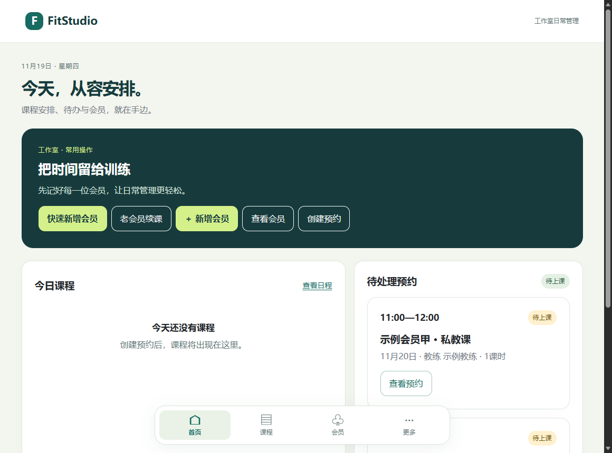
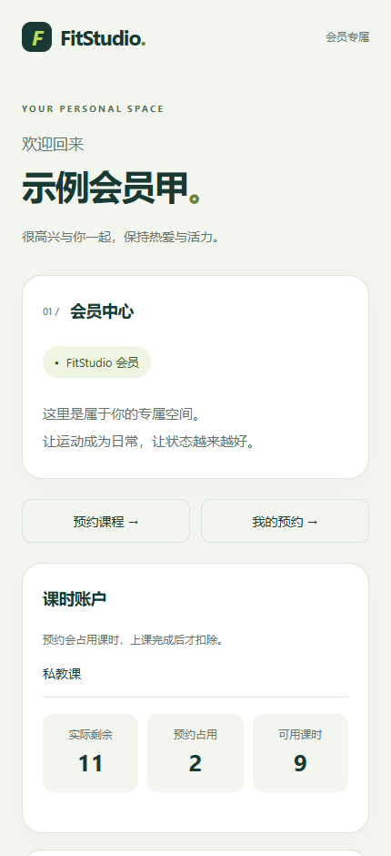
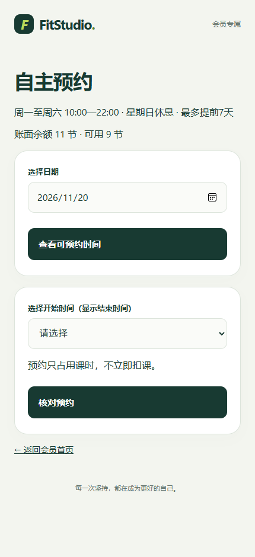
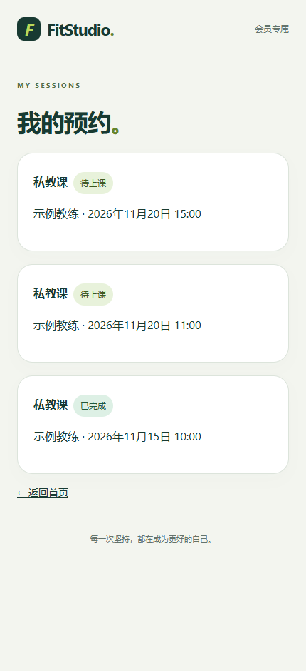
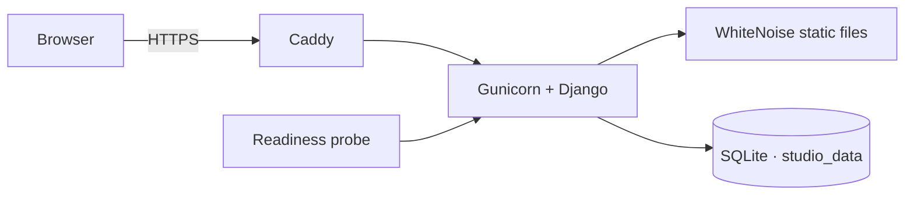

# FitStudio

**Personal Training Studio Management System**

FitStudio is a lightweight, self-hosted application for small personal training studios. It handles member records, purchases, session credits and bookings. Members can book sessions and check their credits, while staff can trace credit deductions and reversals to the relevant transaction. Purchases record payments already received and add session credits. FitStudio does not process online payments.

[简体中文](README.md) · [Docker deployment](docs/deployment.en.md) · [Architecture](docs/architecture/system-architecture.md) · [Engineering evidence](docs/engineering/README.md)



## About

FitStudio grew out of the daily operations of a small personal training studio. The same ledger answers how many sessions a member bought, how many are reserved, and whether a cancellation should charge a credit. Staff workflows and member self-service share an auditable database. Studio operators host the application and control access to their data.

## Features

| Area | Implemented | Verified |
| --- | --- | --- |
| Members and accounts | Create, search, archive and restore records, link login accounts, and onboard with a first-login password change | Member, credential and archive regressions, synthetic onboarding in Docker |
| Purchases and renewals | Record amounts received and snapshot package and credit details with duplicate-request protection | Idempotency and concurrency regressions, synthetic purchases and renewals in Docker |
| Credit balance | Calculate the ledger balance and subtract pending reservations from available credits | Ledger regressions and balance checks after Docker recreation |
| Booking, cancellation and rescheduling | Member self-service, release of credits on normal cancellation, and rescheduling with rule confirmation | Booking confirmation, ownership and concurrency regressions, Docker booking and cancellation |
| Late cancellations and no-shows | Apply studio-date and session-start rules, then charge the booking's credit cost | Boundary tests and controlled-clock Docker verification |
| Coach cancellations and make-up sessions | Release reserved credits and link a make-up session to its predecessor | Make-up regressions and Docker coach cancellation |
| Deductions and reversals | Post a charge after completion and record a separate transaction for a reversal | Deduction and rollback regressions, Docker reversal |
| Administrator, coach and member access | Separate administrative, staff and member permissions | Access regressions, cross-role and cross-member Docker checks |
| Mobile-first workflows | Responsive templates and vanilla JavaScript for member and staff workflows | Mobile and interaction regressions, Phase 3 browser viewport captures |

**Planned** work includes release automation, operational backup improvements and wider device testing. See the [roadmap](ROADMAP.md), [public engineering summary](docs/engineering/phase2-public-summary.md).

## Screenshots







[Member management](docs/screenshots/member-management.png) · [Quick onboarding](docs/screenshots/quick-open.png) · [Quick renewal](docs/screenshots/quick-renew.png) · [Administration](docs/screenshots/admin.png) · [Screenshot index and data provenance](docs/screenshots/README.md)

## Stack and architecture

- Backend: Python 3.12 in the container, Django 5.2.19 and SQLite.
- Frontend: Django templates, vanilla JavaScript and local Bootstrap CSS. Node.js runs interaction tests.
- Deployment: Docker, Docker Compose, Caddy and Gunicorn. WhiteNoise serves static files collected at build time.



[System and deployment diagrams](docs/architecture/system-architecture.md) · [Business flows](docs/architecture/business-flows/README.md)

## Database design

A member profile can have one associated login. Purchases connect members, course types and packages, preserving the price and credits bought at the time. Bookings link a member, course and coach, with records for rescheduling, make-up sessions and audit events. The signed values in the credit ledger produce the balance. Pending bookings reserve credits. Write transactions check overlaps, available credits and duplicate requests. [Entity relationships and migration history](docs/architecture/database-er.md)

## Docker deployment

Install Docker locally with a Compose plugin that supports `up --wait`. From the project root, create a private `.env` with a random secret and confirm the loopback bindings. The first start builds the image, applies SQLite migrations and starts the proxy.

```sh
docker compose version
docker compose -p fitstudio --env-file .env config --quiet
docker compose -p fitstudio --env-file .env up -d --build --wait
docker compose -p fitstudio --env-file .env exec web python manage.py bootstrap_admin studio-owner
```

The default HTTPS endpoint is `https://fitstudio.localhost:8443/`. Trust its local CA explicitly. The [deployment guide](docs/deployment.en.md) covers installation, configuration, key generation, first administrator, TLS, health checks, database backup and isolated restore.

## Testing evidence

| Date | Result | Environment and coverage |
| --- | --- | --- |
| 2026-11-18 | 333 passed in the historical full suite | Windows, Python 3.14.9, Django 5.2.19 and Node 24.22.1. Business rules, permissions, concurrency, interactions and deployment checks. |
| 2026-11-19 | 132 passed in targeted container regression | Linux Web image, Python 3.12 and Django 5.2.19, with networking disabled and disposable SQLite. Core bookings, members and deployment. |
| 2026-11-19 | 12 Docker acceptance checks passed | Docker Engine 29.9.3 and Compose v5.7.0. Migrations 0001–0008, HTTPS sign-in, container permissions, business workflows, durable storage and log sanitization. |

Each figure describes a separate evidence run. The targeted suite overlaps the full suite. [Test and evidence index](docs/engineering/README.md)

## Security and operating limits

- The application uses Django sessions, CSRF protection and signing. It currently needs no external API key. Keep the instance secret, environment file and administrator credentials private. The bootstrap command takes the password in an interactive terminal.
- The Web container runs as UID/GID 10001 with SQLite on a dedicated volume. Request logs omit query strings. Keep personal data out of URL paths and review any additional proxy or log collector.
- Make consistent backups and restore them in isolation. Review TLS, allowed hosts, trusted proxies and administrative access before enabling public traffic. [Security reporting](SECURITY.md) · [Backup and restore](docs/deployment.en.md)
- FitStudio targets small personal training studios. It supports one Web instance with SQLite. Multiple Web instances must never share the database file. PostgreSQL compatibility has yet to be verified. [SQLite decision](docs/engineering/adr/0001-sqlite-single-instance.md)

## Licensing, contributions and credits

Original software that ZZY is authorized to license is available under MIT. Documentation, screenshots and branding retain their respective rights, and third-party components keep their original terms. Once the public repository is enabled, use Issues for changes and Pull Requests for review. [MIT license](LICENSE) · [Content licensing](docs/CONTENT-LICENSE.md) · [Third-party notices](docs/THIRD-PARTY-NOTICES.md) · [Contributing](CONTRIBUTING.md) · [Code of conduct](CODE_OF_CONDUCT.md) · [Changelog](CHANGELOG.md)

ZZY led business modeling, product and technical decisions, development coordination and acceptance. Codex assisted with coding, debugging and testing. [Project authorship](docs/PROJECT-AUTHORSHIP.md)
