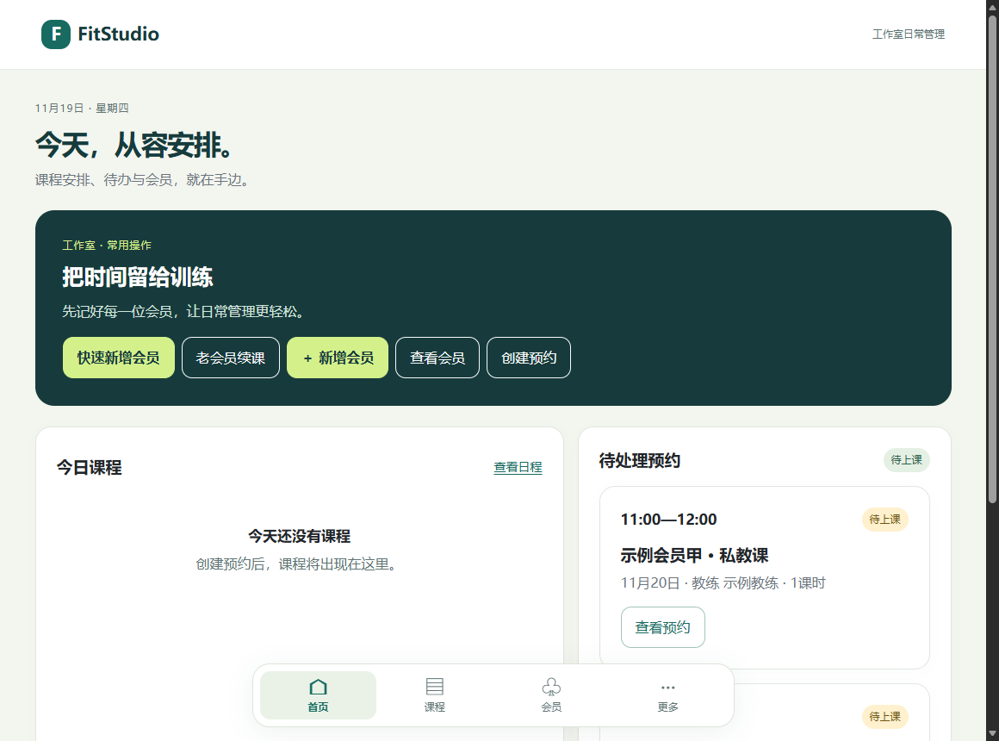
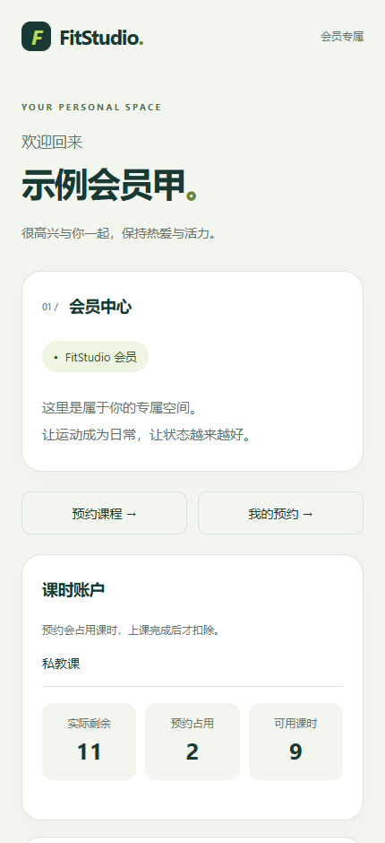
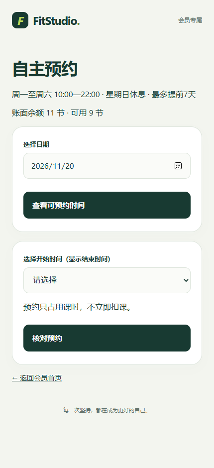
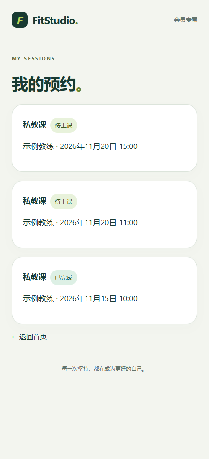
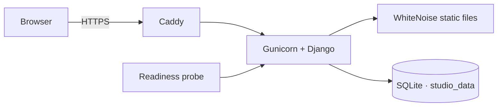

# FitStudio

**Personal Training Studio Management System**

面向小型私人健身工作室的轻量级管理系统。用一套自托管应用管理会员档案、购课、课时和预约。会员可自助预约并查看课时，工作人员可以追溯每次扣课和冲正。购课用于登记已收款项和入账课时，系统不处理线上支付。

[English](README.en.md) · [Docker 部署](docs/deployment.md) · [架构](docs/architecture/system-architecture.md) · [工程验证](docs/engineering/README.md)



## 项目简介

FitStudio 来自小型私教工作室的日常课务需求。买了多少课、预约占了几节、哪次取消应扣课，工作人员和会员需要从同一账本核对。应用把工作人员操作和会员自助入口分开，在同一数据库里记录购课、预约、课时变化及操作原因。工作室在自己的主机上运行服务并保管数据。

## 核心功能

| 功能 | 已实现 | 已验证 |
| --- | --- | --- |
| 会员档案和账号 | 新增、查询、归档与恢复，独立账号绑定，快捷开户及首次改密 | 会员、凭据与归档回归，Docker 合成开户 |
| 购课和续课 | 记录实收金额、课时及套餐快照，防止重复入账 | 幂等及并发回归，Docker 合成购课与续课 |
| 账面余额与可用课时 | 按会员和课程汇总流水、扣除待上课占用 | 账务回归，Docker 持久化核对 |
| 预约、取消与改期 | 会员自主预约，正常取消释放占用，按现有规则确认改期 | 预约确认、归属与并发回归，Docker 自主预约和正常取消 |
| 迟取消与爽约 | 按工作室日期及开课时间分类，按预约快照扣课 | 时间边界回归，Docker 受控时钟验证 |
| 教练取消与补课 | 教练取消释放占用，补课作为后继预约保存 | 补课及状态回归，Docker 教练取消 |
| 扣减与冲正 | 上课完成后扣课，误扣追加反向流水并保留操作记录 | 扣减与回滚回归，Docker 冲正 |
| 管理员、教练、会员权限 | 管理后台、员工业务权限和会员本人访问分离 | 权限回归，Docker 跨角色及跨会员访问验证 |
| 移动端优先交互 | 响应式模板与原生 JavaScript，移动视口可查看预约和课时 | 移动及交互回归，Phase 3 浏览器视口截图 |

**规划中** 为发布自动化、备份恢复运维完善及更广的实机浏览器验证，详见 [路线图](ROADMAP.md)。功能验证范围见 [公共工程摘要](docs/engineering/phase2-public-summary.md)。

## 产品截图







[会员管理](docs/screenshots/member-management.png) · [快捷开户](docs/screenshots/quick-open.png) · [快捷续课](docs/screenshots/quick-renew.png) · [管理员后台](docs/screenshots/admin.png) · [截图索引与数据来源](docs/screenshots/README.md)

## 技术栈与架构

- 后端采用 Python 3.12 容器、Django 5.2.19、SQLite。
- 前端使用 Django 模板、原生 JavaScript 和本地 Bootstrap CSS。Node.js 用于测试。
- 部署使用 Docker、Docker Compose、Caddy、Gunicorn。WhiteNoise 提供构建时收集的静态文件。



[完整系统和部署图](docs/architecture/system-architecture.md) · [业务流程图](docs/architecture/business-flows/README.md)

## 数据库设计

会员档案可绑定一个登录账号。购买记录关联会员、课程和套餐，保存购课时的金额和课时。预约关联会员、课程和教练，保留改期、补课链和操作记录。课时余额由带符号的流水合计，待上课预约占用可用课时。数据库在写事务中校验冲突、余额和重复请求。 [实体关系图与迁移历史](docs/architecture/database-er.md)

## Docker 部署

在本机安装 Docker 和支持 `up --wait` 的 Compose 插件。从项目根目录生成私有 `.env`、随机密钥并核对回环绑定，再运行以下命令。首次运行会建镜像、初始化 SQLite 迁移并启动代理。

```sh
docker compose version
docker compose -p fitstudio --env-file .env config --quiet
docker compose -p fitstudio --env-file .env up -d --build --wait
docker compose -p fitstudio --env-file .env exec web python manage.py bootstrap_admin studio-owner
```

默认 HTTPS 地址为 `https://fitstudio.localhost:8443/`，需要显式信任该实例的本机 CA。 [完整部署手册](docs/deployment.md) 含安装、环境变量、密钥生成、首位管理员、TLS、健康检查及 SQLite 备份和隔离恢复命令。

## 测试证据

| 日期 | 结果 | 环境和范围 |
| --- | --- | --- |
| 2026-11-19 | 333 项 Phase 4B 候选全量自动化测试通过 | Windows、Python 3.14.9、Django 5.2.19、Node 24.22.3。使用候选隔离副本和独立 SQLite，覆盖业务、权限、并发、交互和部署专项。 |
| 2026-11-19 | 132 项容器内定向回归通过 | Linux Web 镜像、Python 3.12、Django 5.2.19，断网和独立 SQLite。覆盖核心课务、会员和部署用例。 |
| 2026-11-19 | 12 项 Docker 实机验收通过 | Docker Engine 29.9.3、Compose v5.7.0。覆盖迁移 0001–0008、HTTPS 登录、容器权限、业务、重建持久化及脱敏。 |

三个数字分别记录各次验收。容器定向回归与全量套件存在覆盖重叠。 [测试与复现索引](docs/engineering/README.md)

## 安全与适用范围

- 应用使用 Django 会话、CSRF 和签名，当前无需外部 API 密钥。保护私有环境文件、随机密钥和管理员凭据。管理员命令只在交互终端获取密码。
- Web 容器使用非 root UID/GID 10001，SQLite 保存在单实例私有卷。请求日志去除查询串。切勿把个人信息放入 URL 路径，检查额外代理或日志平台的采集规则。
- 定期做一致性备份，在隔离项目验证恢复。对外发布站点前核对 TLS、Host、代理信任和管理入口访问范围。 [安全报告方式](SECURITY.md) · [备份和恢复](docs/deployment.md)
- 适用于小型私人健身工作室。当前只支持单 Web 实例的 SQLite，多个 Web 实例不能共享数据库文件，PostgreSQL 尚未通过兼容验证。功能范围以实际版本为准。 [SQLite 决策](docs/engineering/adr/0001-sqlite-single-instance.md)

## 许可、贡献与署名

ZZY 有权授权的原创软件代码采用 MIT。文档、截图和品牌保留各自权利，第三方内容沿用上游许可。公开仓库启用后，可按贡献指南用 Issue 记录问题、用 PR 提交改进。 [MIT 许可证](LICENSE) · [内容许可](docs/CONTENT-LICENSE.md) · [第三方声明](docs/THIRD-PARTY-NOTICES.md) · [贡献指南](CONTRIBUTING.md) · [行为准则](CODE_OF_CONDUCT.md) · [变更记录](CHANGELOG.md)

ZZY 负责业务建模、产品与技术决策、开发协调和验收。Codex 辅助编写代码、调试和测试。 [项目贡献说明](docs/PROJECT-AUTHORSHIP.md)
