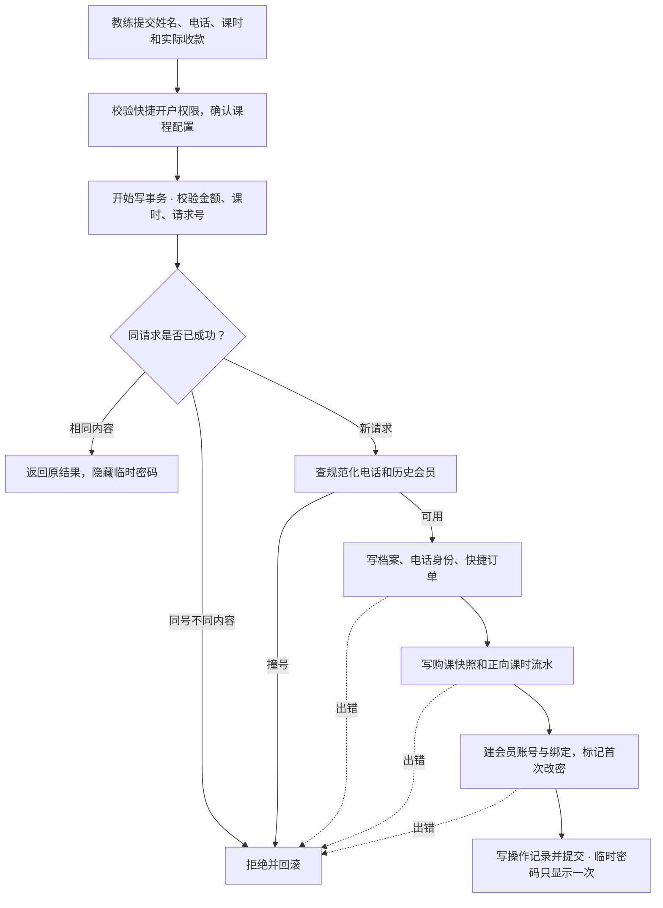

# 新会员开通与首次购课

金额独立填写，系统记录实际收款。新档案、订单、购课流水、登录账号与审计同成同败。重复提交相同请求返回既有结果，临时密码不会再次显示。会员首次登录须先改密。

[快捷购课服务](../../../studio/quick_services.py) · [凭据服务](../../../studio/credential_services.py) · [测试](../../../studio/tests/test_quick.py)
