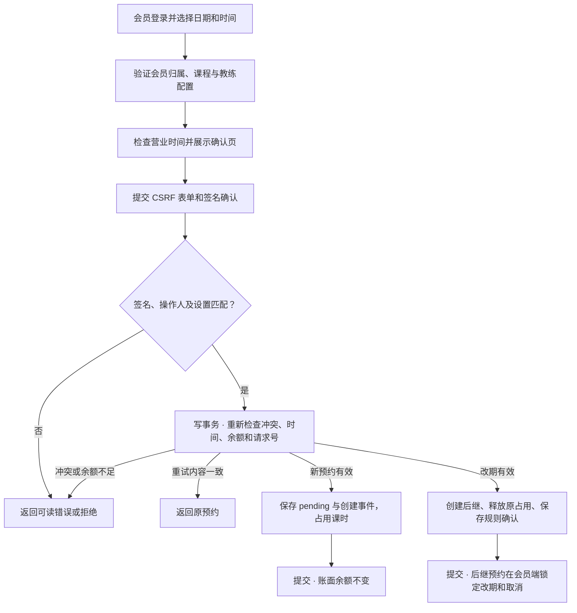

# 会员自主预约与改期

V2 自主预约使用配置的教练和标准 60 分钟、1 课时课程。工作室时区为 Asia/Shanghai。周一至周六，10:00–21:00 整点或半点开始，22:00 前或恰好 22:00 结束。提前天数由实例配置。签名确认有效期一小时。改期检查原预约状态、归属与原时间，保留时长并记录规则版本。

[预约视图](../../../studio/booking_v2_views.py) · [预约事务](../../../studio/booking_v2.py) · [测试](../../../studio/tests/test_booking_v2.py)
