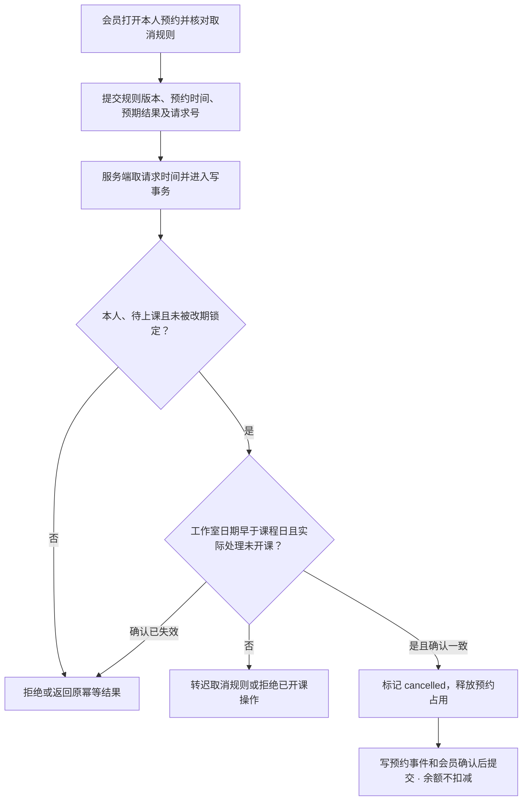

# 正常取消

按工作室日期判断。课程前一日或更早取消属于正常取消。工作人员操作另按权限校验，会员端写入所确认的规则。时段或分类变化要求重新确认。历史不可分类取消保留独立状态。

[会员事务](../../../studio/portal_services.py) · [取消分类](../../../studio/services.py) · [规则测试](../../../studio/tests/test_m4_rules.py)
