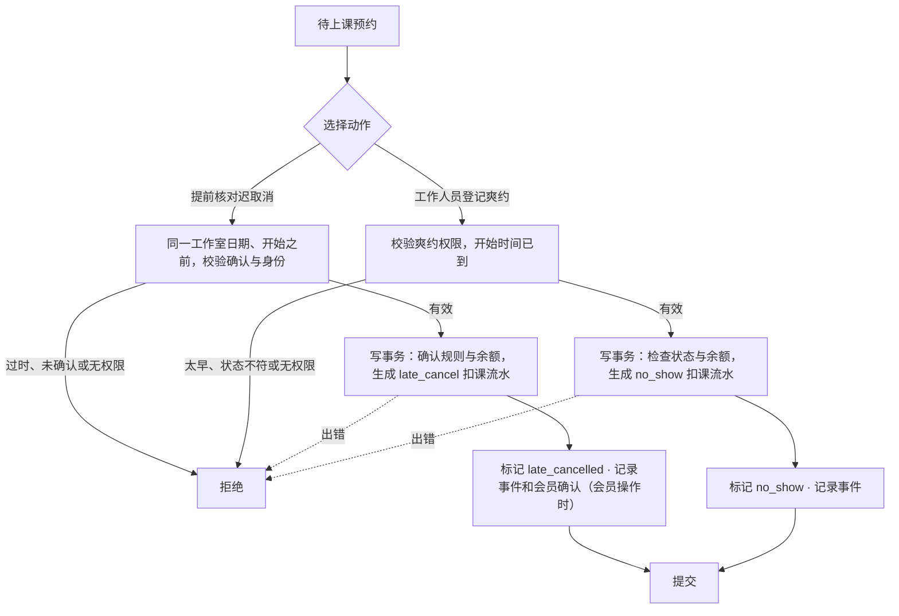

# 迟取消与爽约

迟取消和爽约都产生负向流水，额度取预约课时快照。迟取消员工入口需要单独权限，会员按归属和规则确认授权。预约开始后不能再执行会员取消。重复扣减受状态与数据库唯一约束限制。

[课务服务](../../../studio/services.py) · [会员规则](../../../studio/portal_rules.py) · [测试](../../../studio/tests/test_m4_rules.py)
