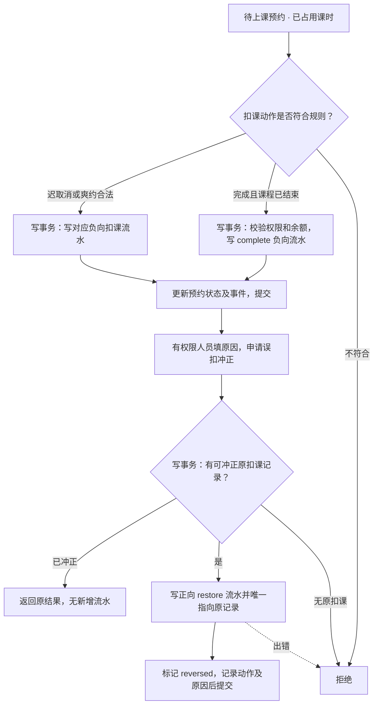

# 课时扣减与冲正

课时账面余额为按会员和课程汇总的流水差额。可预约数再扣除待上课占用。冲正追加反向记录，原扣课保持可追溯。每项业务在独立写事务内完成，事务失败不会留下半笔。

[课时服务](../../../studio/services.py) · [流水约束](../../../studio/models.py) · [测试](../../../studio/tests/test_bookings.py)
