# 数据库实体关系 · Database ER

单个 SQLite 文件保存 Django 身份、会员档案、课务、流水及操作记录。图展示实际模型及关键字段。省略 Django ContentType、Session、迁移历史、隐式多对多中间表和部分显示字段。字段为 Django FK 底层列名，带复合条件的约束见下文。

## 核心业务实体

| 实体 | 职责与约束 |
| --- | --- |
| User / Group / Permission | Django 自带账号及角色权限。员工和管理员由标志及权限区分，教练档案独立保存，无指向教练登录账号的外键。 |
| Member / MemberAccount / Coach | 会员与账号通过可选的一对一绑定，教练档案供预约选择。归档成员及非活跃账号不能继续按活跃身份访问会员端。 |
| CourseType / Package / Purchase | 课程和套餐定义价格与课时，购课保存购买时的套餐名、金额、课时及操作人快照。 |
| Booking | 记录会员、教练、课程、时间窗、状态和课时成本。旧时段可空，自主预约不需要时段。前驱为可空唯一外键，补课来源为可空多对一。 |
| LessonEntry / LessonAdjustment | 课时通过带符号流水累加。购课、扣课、冲正和调整按类型约束关联及符号。预约最多一条扣课流水，冲正只能一次关联同一原流水。待上课预约占用可用课时。 |

## 辅助实体

| 实体 | 作用 |
| --- | --- |
| QuickOrder / QuickPackage / MemberPhoneIdentity | 快捷开户与续课请求去重、稳定内部套餐、标准化的快捷开户电话身份。普通会员历史电话可以重复，唯一性来自辅助表及快捷开户检查。 |
| AvailableSlot / MemberRuleConfirmation | 兼容旧发布时段，记录取消和改期的规则版本及会员确认。 |
| BookingEvent / MemberArchiveEvent / Django LogEntry | 记录预约动作、档案归档和恢复、后台操作。Django LogEntry 用 ContentType 和对象 ID 指向记录目标。 |
| CredentialState | 标记强制首次改密，凭据哈希由 Django User 管理。 |

## 关系图

```mermaid
erDiagram
    USER }o--o{ GROUP : member_of
    GROUP }o--o{ PERMISSION : grants
    USER }o--o{ PERMISSION : direct_grants
    USER ||--o| MEMBER_ACCOUNT : authenticates
    MEMBER ||--o| MEMBER_ACCOUNT : binds
    USER ||--o| CREDENTIAL_STATE : tracks
    MEMBER ||--o| MEMBER_PHONE_IDENTITY : owns
    COURSE_TYPE ||--o{ PACKAGE : offers
    COURSE_TYPE ||--o| QUICK_PACKAGE : maps
    PACKAGE ||--o| QUICK_PACKAGE : template
    MEMBER ||--o{ PURCHASE : buys
    PACKAGE ||--o{ PURCHASE : sold_as
    COURSE_TYPE ||--o{ PURCHASE : credited_to
    USER ||--o{ PURCHASE : records
    MEMBER ||--o{ QUICK_ORDER : placed_for
    PACKAGE ||--o{ QUICK_ORDER : priced_from
    USER ||--o{ QUICK_ORDER : processes
    PURCHASE |o--o| QUICK_ORDER : fulfills
    COURSE_TYPE ||--o{ AVAILABLE_SLOT : defines
    COACH ||--o{ AVAILABLE_SLOT : hosts
    AVAILABLE_SLOT |o--o{ BOOKING : optional_slot
    MEMBER ||--o{ BOOKING : attends
    COACH ||--o{ BOOKING : teaches
    COURSE_TYPE ||--o{ BOOKING : describes
    USER ||--o{ BOOKING : creates
    BOOKING |o--o| BOOKING : predecessor
    BOOKING |o--o{ BOOKING : makeup_origin
    MEMBER ||--o{ LESSON_ENTRY : owns
    COURSE_TYPE ||--o{ LESSON_ENTRY : tracks
    PURCHASE |o--o| LESSON_ENTRY : credits
    BOOKING |o--o{ LESSON_ENTRY : books_or_reverses
    LESSON_ENTRY |o--o| LESSON_ENTRY : reverses
    LESSON_ADJUSTMENT |o--o| LESSON_ENTRY : adjusts
    USER ||--o{ LESSON_ENTRY : posts
    MEMBER ||--o{ LESSON_ADJUSTMENT : receives
    COURSE_TYPE ||--o{ LESSON_ADJUSTMENT : applies_to
    USER ||--o{ LESSON_ADJUSTMENT : records
    BOOKING ||--o{ BOOKING_EVENT : has
    USER ||--o{ BOOKING_EVENT : performs
    USER ||--o{ MEMBER_RULE_CONFIRMATION : confirms
    MEMBER ||--o{ MEMBER_RULE_CONFIRMATION : acknowledges
    BOOKING ||--o{ MEMBER_RULE_CONFIRMATION : applies_to
    BOOKING |o--o{ MEMBER_RULE_CONFIRMATION : produces
    MEMBER ||--o{ MEMBER_ARCHIVE_EVENT : has
    USER |o--o{ MEMBER_ARCHIVE_EVENT : account_snapshot
    USER ||--o{ MEMBER_ARCHIVE_EVENT : records
    USER ||--o{ ADMIN_LOG_ENTRY : performs

    USER {
        int id PK
        string username UK
        boolean is_staff
        boolean is_superuser
        boolean is_active
    }
    GROUP {
        int id PK
        string name UK
    }
    PERMISSION {
        int id PK
        string codename
        int content_type_id FK
    }
    MEMBER {
        int id PK
        string name
        string phone
        string status
        date joined_on
    }
    MEMBER_ACCOUNT {
        int id PK
        int user_id FK, UK
        int member_id FK, UK
    }
    COACH {
        int id PK
        string name
        string specialty
        string status
    }
    COURSE_TYPE {
        int id PK
        string name
        int duration_minutes
        int credits_cost
        boolean active
    }
    PACKAGE {
        int id PK
        int course_type_id FK
        string name
        int credits
        decimal price
        boolean active
    }
    PURCHASE {
        int id PK
        int member_id FK
        int package_id FK
        int course_type_id FK
        int created_by_id FK
        uuid request_id UK
        string package_name
        int credits
        decimal amount
        date purchased_on
    }
    BOOKING {
        int id PK
        int member_id FK
        int coach_id FK
        int course_type_id FK
        int slot_id FK
        int previous_booking_id FK, UK
        int makeup_origin_id FK
        int created_by_id FK
        uuid request_id UK
        datetime starts_at
        datetime ends_at
        int credits_cost
        string status
        string replacement_type
    }
    LESSON_ENTRY {
        int id PK
        int member_id FK
        int course_type_id FK
        int purchase_id FK, UK
        int booking_id FK
        int adjustment_id FK, UK
        int reverses_id FK, UK
        int created_by_id FK
        string kind
        int delta
        int balance_before
        int balance_after
    }
    LESSON_ADJUSTMENT {
        int id PK
        int member_id FK
        int course_type_id FK
        int created_by_id FK
        uuid request_id UK
        int delta
        datetime occurred_at
    }
    AVAILABLE_SLOT {
        int id PK
        int course_type_id FK
        int coach_id FK
        datetime starts_at
        int duration_minutes
        boolean active
    }
    QUICK_ORDER {
        int id PK
        int actor_id FK
        int member_id FK
        int package_id FK
        int purchase_id FK, UK
        uuid request_id UK
        string fingerprint
        string mode
    }
    QUICK_PACKAGE {
        int id PK
        int course_type_id FK, UK
        int package_id FK, UK
    }
    MEMBER_PHONE_IDENTITY {
        int id PK
        int member_id FK, UK
        string phone UK
    }
    CREDENTIAL_STATE {
        int id PK
        int user_id FK, UK
        boolean required_change
    }
    BOOKING_EVENT {
        int id PK
        int booking_id FK
        int created_by_id FK
        string action
        string reason
        json details
    }
    MEMBER_RULE_CONFIRMATION {
        int id PK
        int user_id FK
        int member_id FK
        int booking_id FK
        int result_booking_id FK
        uuid request_id UK
        string rule_version
    }
    MEMBER_ARCHIVE_EVENT {
        int id PK
        int member_id FK
        int created_by_id FK
        int account_user_id FK
        string action
        string previous_status
    }
    ADMIN_LOG_ENTRY {
        int id PK
        int user_id FK
        int content_type_id FK
        string object_id
        string change_message
    }
```

## 迁移脉络

| 迁移 | 内容 |
| --- | --- |
| 0001 | 会员与教练档案。 |
| 0002 | 课程类型、套餐、购课、预约、流水及预约事件。 |
| 0003 | 扩展预约状态和替换关系，调整流水约束，保留历史未分类的取消。 |
| 0004 | 增加课时调整和相应流水关联。 |
| 0005 | 增加会员登录绑定。 |
| 0006 | 增加可预约时段与会员规则确认，补齐可选预约关联。 |
| 0007 | 增加快捷订单、套餐模板与电话身份。 |
| 0008 | 增加凭据状态和档案归档事件，扩展档案状态及权限。 |

[Mermaid 源文件](database-er.mmd) · [模型](../../studio/models.py) · [凭据模型](../../studio/credential_models.py) · [迁移目录](../../studio/migrations/) · [单实例数据库决策](../engineering/adr/0001-sqlite-single-instance.md)
