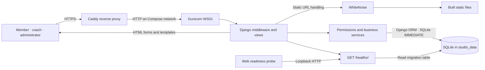
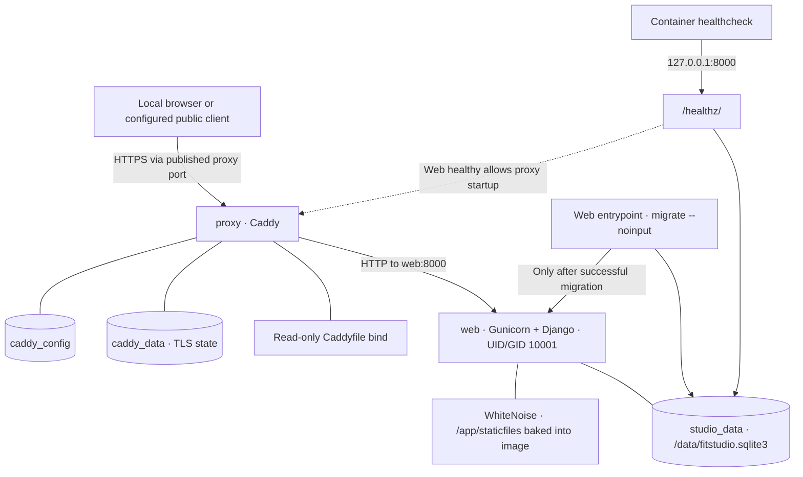

# 系统架构 · System architecture

FitStudio 是一套用 Django 模板渲染页面的单体 Web 应用。会员端、教练工作台和管理员后台共享应用与数据库，权限分别由员工身份、操作权限或活跃的会员绑定检查。前端为原生 JavaScript 和本地 Bootstrap CSS，Node.js 用于测试。

## 请求和数据

- Caddy 终止 HTTPS，把请求转给 Compose 网络内的 Gunicorn。Django 使用会话和 CSRF，身份与业务对象归属由服务端验证。Caddy 启动依赖 Web 健康。
- WhiteNoise 在 WSGI 应用的中间件链处理静态资源。镜像构建时执行 `collectstatic`。Django 模板渲染业务页面，浏览器加载静态 CSS 和 JS。
- 快捷购课、预约和课时变更由 Django ORM 写入同一个 SQLite 文件。写事务使用 `IMMEDIATE`，预约冲突、余额和幂等检查跟写入在同一事务中。
- 探针在 Web 容器内访问 `/healthz/`，使用配置的 Host 头与 HTTPS 代理标记。端点核对数据库可读及应用迁移记录存在。发布验收另用 `showmigrations` 核对全部版本。

## 容器部署

默认映射本机回环端口，Caddy 使用独立本机 CA。公网配置是部署者另行选择的配置。Web 不发布宿主端口，SQLite 保存在 Web 专用具名卷，Caddy 的配置与证书状态使用各自的卷。容器入口先跑迁移再启动 Gunicorn。

[系统图源](system-architecture.mmd) · [部署图源](deployment-architecture.mmd) · [数据库模型](database-er.md) · [业务流程](business-flows/README.md) · [SQLite 决策](../engineering/adr/0001-sqlite-single-instance.md) · [部署手册](../deployment.md)

代码来源为 [Compose](../../docker-compose.yml)、[Dockerfile](../../Dockerfile)、[容器入口](../../deploy/entrypoint.sh)、[生产设置](../../config/production_settings.py)、[探针](../../config/check_health.py) 和 [健康端点](../../config/health.py)。
