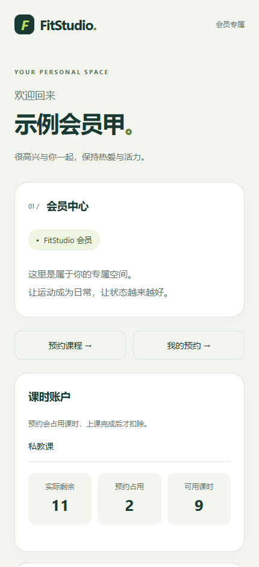
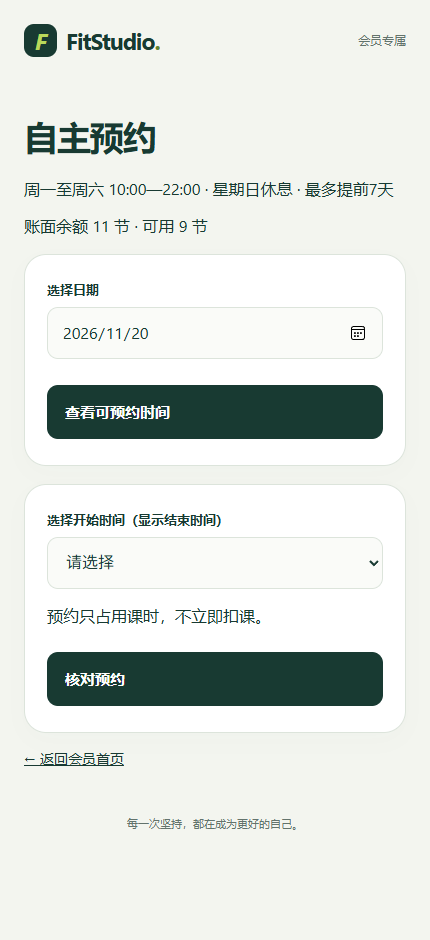
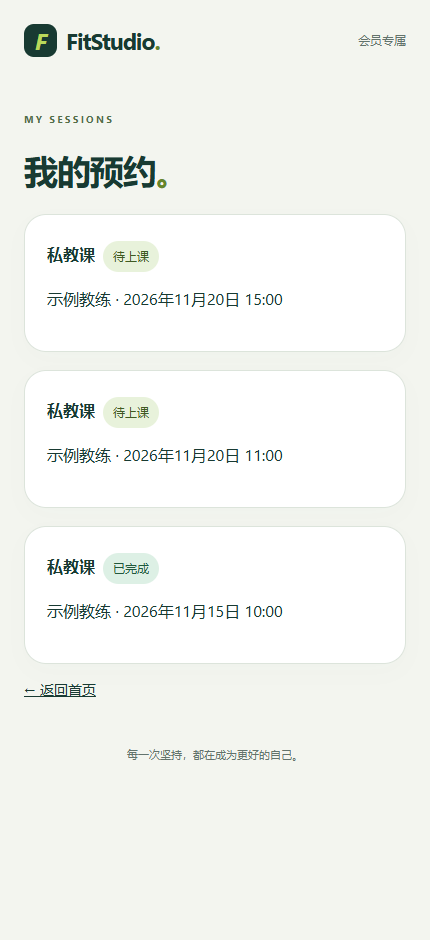
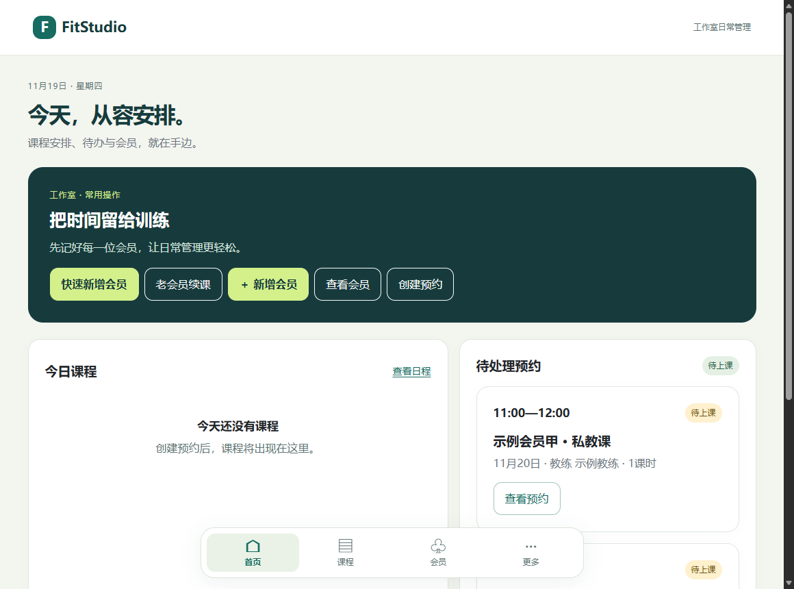
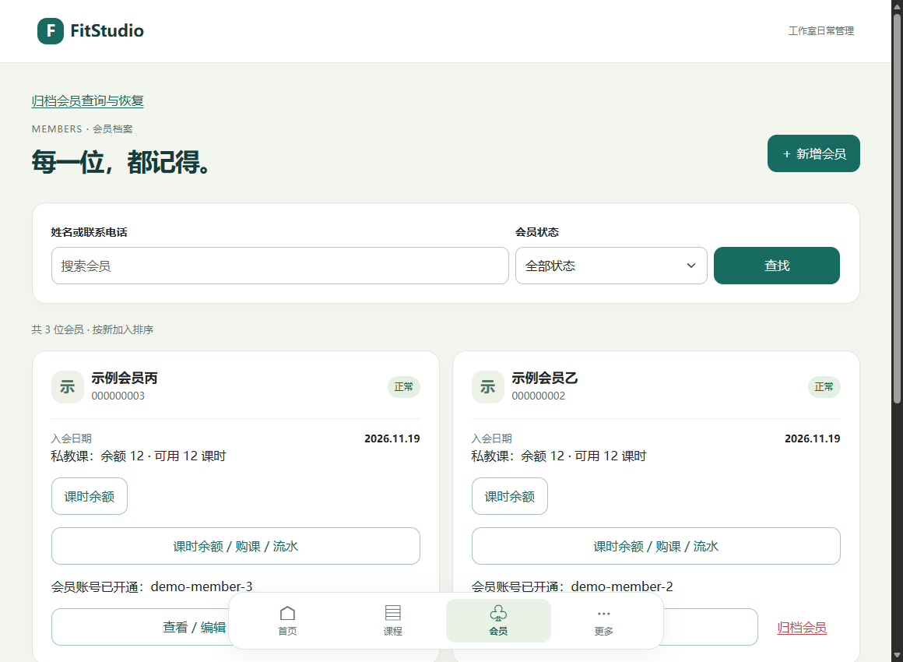
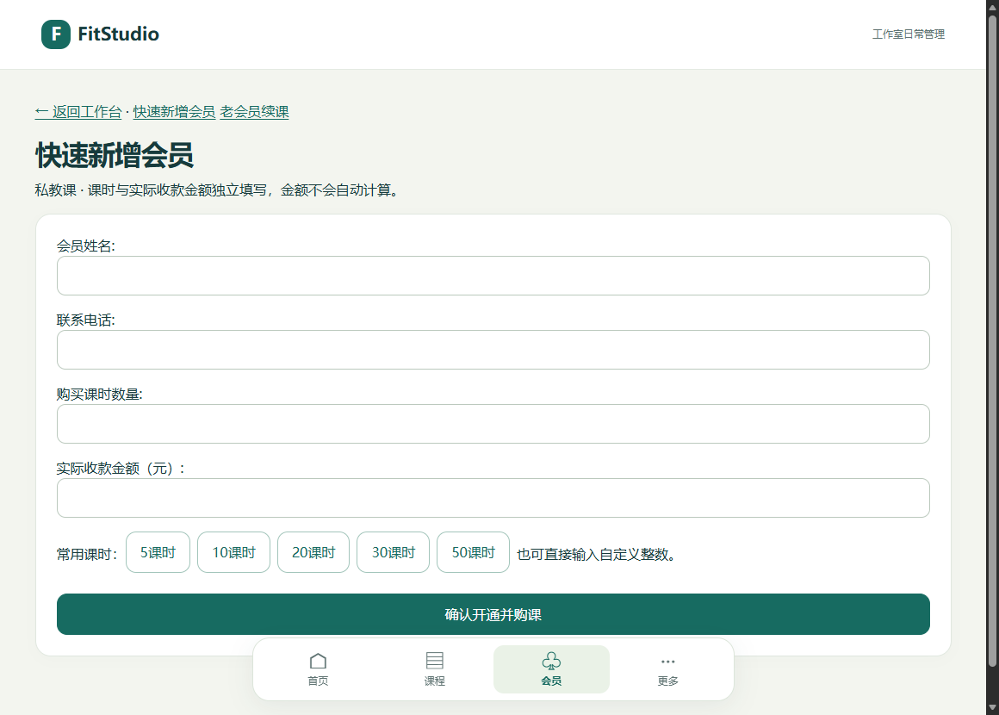
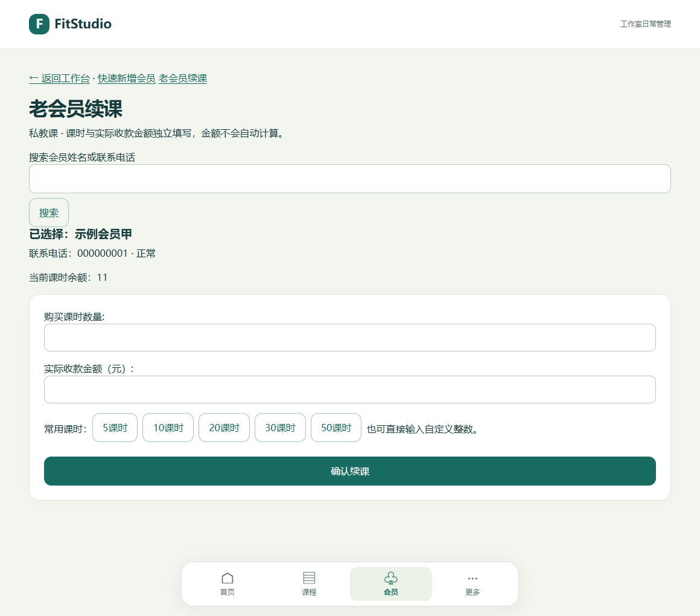
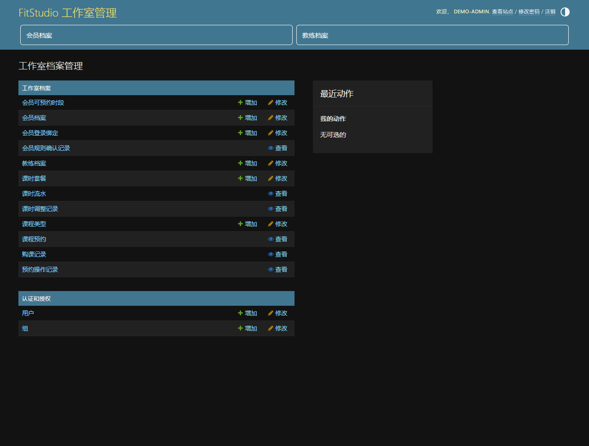

# 产品截图 · Product screenshots

2026-11-19 使用真实 FitStudio 模板与本机隔离 SQLite 生成。示例姓名、账号、占位号码、日期和账目均为合成数据。截图只包含网站视口。会员端为 430 px 宽的移动视口，工作人员界面为桌面视口。

## 会员首页 · Member home

## 会员自主预约 · Member booking

## 会员预约记录 · Booking history

## 教练工作台 · Coach dashboard

## 会员管理 · Member management

## 快捷开户 · Quick onboarding

## 快捷续课 · Quick renewal

## 管理后台 · Administration

后台截图中的 Django Admin 图标来自 Django 5.2.19，由 Code Charm Ltd 持有版权并采用 MIT。 [图标许可证全文](../licenses/Django-Admin-Icons-MIT.txt)

[截图生成和隐私核对](../engineering/phase3-public-summary.md) · [截图许可范围](../CONTENT-LICENSE.md)
